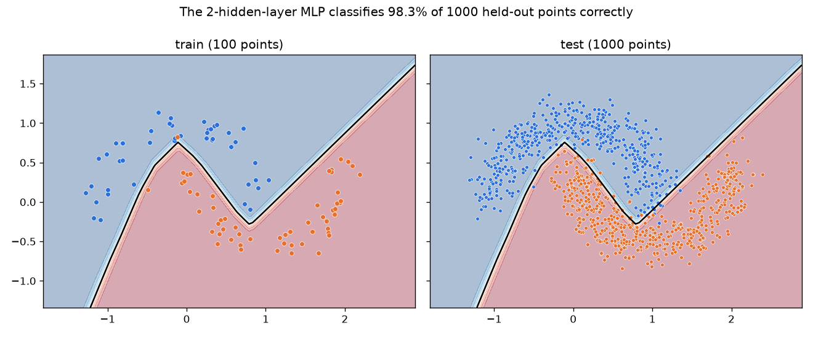
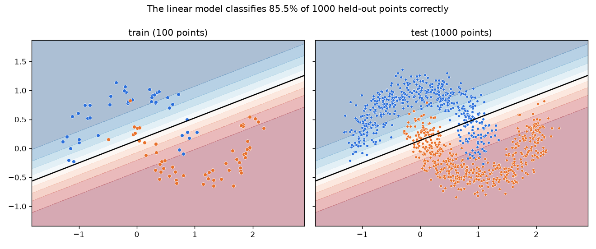
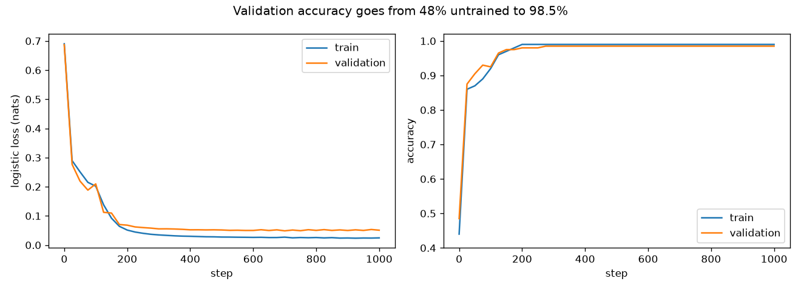
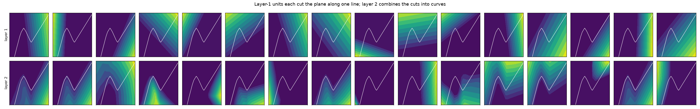
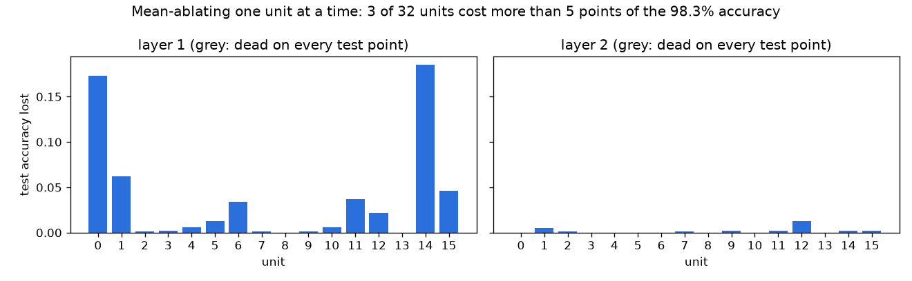
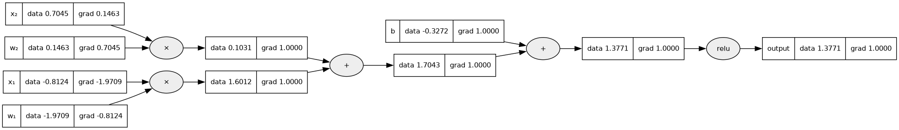

# tiny-autograd

**Backpropagation from scratch.** A micrograd-style scalar autograd engine and tiny MLP, built to make `loss.backward()` stop being magic.

**Status:** done. The stretch goal is half done: the NumPy tensor engine is built and tested; retraining clockwork-tfm on it waits for clockwork-tfm (see [What is not done](#what-is-not-done)).

A learning exercise in the style of Karpathy's micrograd. Nothing else imports it.

## Goal

Make `loss.backward()` stop being magic by building backpropagation from scratch.

## Results

**A 337-parameter MLP trained entirely by the hand-built engine classifies 97.7–98.4% of held-out points correctly across three seeds.** No straight line separates the two moons, and the linear baseline, trained the same way, gets 85.5%.

| Model (test set: 1,000 points) | Test loss (nats) | Test accuracy |
| --- | --- | --- |
| Majority class (from train) | — | 51.8% |
| Untrained network, same init (seeds 0–2) | — | 45.7–51.8% |
| Linear model: `--model.hidden` (seed 0) | 0.296 | 85.5% |
| MLP 2-16-16-1, seed 0 | 0.055 | 98.3% |
| MLP 2-16-16-1, seed 1 | 0.061 | 97.7% |
| MLP 2-16-16-1, seed 2 | 0.058 | 98.4% |

All runs: two moons with noise 0.15, 100 training points, 200 validation points and 1,000 test points (data seed 0, the same for every run); ReLU; full-batch SGD at learning rate 0.5 for 1,000 steps. The test set was scored once per run, on the final weights.



*Run `default-seed0`. The black line is where the predicted probability crosses 0.5. Train points are large, test points small. 17 test points are misclassified, and only 3 of them lie closer to the other moon's arc than to their own: most errors come from where the boundary runs, not from noise pushing points across.*



*Run `linear-seed0`, the baseline. A single line has to cut through both moons' tips.*



*Run `default-seed0`. Validation accuracy passes 97% by step 150 and settles at 98.5%. Training accuracy stops at 99%: the one miss is a lower-moon point at (−0.12, 0.82) that noise pushed to about equal distance from both arcs, and the network doesn't bend round it.*

**The scalar engine matches PyTorch to rounding error.** The tests check every op, a composed graph that reuses intermediates, and every parameter's gradient in a two-layer network against PyTorch in float64. Twenty SGD steps of the scalar MLP track the same steps in PyTorch to a relative error under 10⁻¹⁰.

**The tensor engine trains the identical model about 900× faster.** `--engine tensor` copies the scalar model's starting weights and runs the same maths with one NumPy array per node. Its loss matches the scalar run at every logged step to a relative error of 2 × 10⁻¹⁵, and its test accuracy is the same 98.3%. A step takes 0.12 s on the scalar engine and 0.00013 s on the tensor engine (1,000 steps in 123 s against 0.1 s). The scalar graph for one step has about 68,000 Value nodes.

### What the hidden layers compute



*Run `default-seed0`. Each panel shows one hidden unit's activation over the input plane (yellow is high), with the model's decision boundary in white. A layer-1 unit is a ReLU of a weighted sum of the two inputs, so it can only switch on across a straight line. Layer-2 units add up several of those half-planes, so their regions have corners.*

**The first layer does the essential work in a few units; the second layer spreads it out.** Mean-ablating one hidden unit at a time (freezing it at its average activation over the test set) and rescoring the test set:

| Mean-ablating one unit | Seed 0 | Seed 1 | Seed 2 |
| --- | --- | --- | --- |
| Layer-1 units costing more than 5 points | 3 of 16 | 4 of 16 | 4 of 16 |
| Largest single layer-1 cost | 18.5 points | 27.0 points | 20.2 points |
| Largest single layer-2 cost | 1.3 points | 1.6 points | 1.6 points |
| Dead units (never active on a test point) | 1 | 2 | 5 |



*Run `default-seed0`. Layer 1, left; layer 2, right.*

Removing one of the key first-layer units removes one of the lines the boundary is built from, so the boundary loses a whole segment. No single second-layer unit matters much. That is consistent with several layer-2 units carrying overlapping versions of the same signal. Single-unit ablation can't tell redundancy from irrelevance, though: ablating pairs or groups would.

### The computation graph



*One active first-layer neuron of `default-seed0` on one test point, after `backward()`. Read it right to left: the output's gradient is 1; relu and + pass it through unchanged; each × hands each input the other input's value, so w₁'s gradient is x₁'s value and vice versa.*

`analyze.py` also draws the full graph for the loss of a 2-2-1 tanh network on one point ([figures/graph-toy-network.png](figures/graph-toy-network.png)). That is as large as a graph gets while staying readable.

### Negative results and limits

- **Python's garbage collector made the scalar engine 4× slower.** In the first version each op's `_backward` closure referred to its own output node, so every node sat in a reference cycle. Each step's graph (68,000 nodes) then had to wait for Python's cycle collector, which re-scans every live object as more are allocated. In a timing script running 20 steps of the default model, a step took 0.67 s. Passing the gradient into `_backward` as an argument removed the cycles: 0.48 s. Pausing the collector entirely brought it to 0.15 s. Training now pauses it (safe without cycles: a test checks that a dropped graph leaves nothing for `gc.collect()` to find), and the full runs average 0.12 s per step. micrograd's original design has the same cycles.
- **The hyperparameters were not tuned.** The learning rate (0.5), the number of steps (1,000) and the layer sizes were picked once, by looking at validation curves from a tensor-engine run, and not searched. The test set played no part.
- **The boundary is only meaningful near the data.** Away from the moons it carries on as straight lines that no data supports (see the corners of the boundary plot).
- **Single-unit ablation is the only intervention.** It shows which units the decision depends on individually, not how units work together.

## How it works

**A Value is a number that remembers where it came from.** `Value(2.0) * Value(3.0)` returns a new Value holding 6.0, plus a tuple of its two inputs and a `_backward` closure. The closure knows the local derivative of ×: the gradient reaching the product, multiplied by the other input. Run a whole network on Values and you get a graph of every arithmetic step, built as a side effect of computing the answer. See [`engine.py`](src/tiny_autograd/engine.py).

**`backward()` is the chain rule applied in the right order.** It sets the output's gradient to 1, then visits every node in reverse topological order: a node is processed only after every node that used it. At that point its gradient is complete (the sum over every path to the output), so it can pass its share on to its inputs. The topological sort is an iterative depth-first search, because summing a loss over 100 points chains 100 additions, and a recursive search that deep would hit Python's recursion limit.

**Gradients add up, which is why `zero_grad()` exists.** A Value used twice, like x in x·x + x, gets a gradient from each use, so every `_backward` adds to its inputs' `.grad` rather than overwriting it. The same rule means calling `backward()` twice doubles the gradients on leaves (parameters and inputs), exactly as in PyTorch, so the training loop zeroes them before each step. Intermediate Values are reset inside `backward()`, so calling it twice stays correct. micrograd's original version doesn't do this.

**The rest is ordinary deep learning written in Values.** A `Neuron` is a weighted sum plus a bias, then ReLU or tanh. Its weights start uniform in ±1/√n_in, PyTorch's default for `nn.Linear`, so the sum's spread doesn't grow with the number of inputs. A `Layer` is a list of neurons and an `MLP` a list of layers ending in one linear output, a logit. The loss is binary cross-entropy on the logit, log(1 + e^−logit) for class 1. For a confidently wrong logit e^−logit would overflow, so the code switches to the equal form z + log(1 + e^−z), which never exponentiates a positive number. `SGD.step()` moves each parameter against its gradient. See [`nn.py`](src/tiny_autograd/nn.py).

**The tensor engine changes the unit of work, not the idea.** In [`tensor.py`](src/tiny_autograd/tensor.py) each node holds a NumPy array, so a matrix multiply over the whole batch is one node. Two things are new:

- **Matrix derivatives.** For out = a @ b, the gradient for a is (gradient of out) @ bᵀ, and for b it is aᵀ @ (gradient of out). Checking the shapes is the quickest way to remember which.
- **Undoing broadcasting.** Adding a bias of shape [16] to a batch of shape [100, 16] uses each bias 100 times. A value used 100 times collects 100 gradients, so `unbroadcast` sums the incoming gradient back down to [16].

The engine also has softmax cross-entropy, fused because its combined gradient is simply (softmax − one-hot) / n, and AdamW. Both are checked against PyTorch.

## Plan

- **Core:** a scalar `Value` class supporting +, −, ×, ÷, power, exp, log, tanh and relu, each with its local derivative. `backward()` topologically sorts the graph and applies the chain rule in reverse. Done; log was added for the logistic loss.
- **On top:** `Neuron`, `Layer` and `MLP` classes, plain SGD, and a training run on a 2D toy dataset (two moons) with a decision-boundary plot. Done.
- **Extras:** draw the computation graph (graphviz). Tests compare every gradient against PyTorch. Done.
- **Stretch goal:** a tensor version on NumPy arrays (matmul, broadcasting-aware gradients, softmax with cross-entropy, AdamW), then retrain clockwork-tfm on it. The tensor engine is done; the retraining is not.

### What is not done

Retraining clockwork-tfm on the tensor engine. clockwork-tfm is still a scaffold (its original training and inference scripts haven't been added yet), and a transformer needs ops this engine lacks: embedding lookup (gather), reshape and transpose for splitting attention heads, and batched matmul. `cross_entropy` and `AdamW` are already in place for it.

## Done when

The general checklist:

Apply this checklist with the project-specific requirements and exceptions in
[CLAUDE.md](CLAUDE.md#project-specific-scope).

- `just quick` runs end to end on CPU in under 5 minutes, as a smoke test. It takes about a second.
- The scalar implementation runs on CPU; GPU detection and PyTorch model interfaces are
  not required. PyTorch is used as a reference in tests.
- Each run saves reloadable scalar parameters, architecture settings, `metrics.json`
  and its plots to `runs/<run-name>/`; safetensors is not required.
- This README shows the headline result with plots, compares against baselines, and states negative results plainly.
- Tests cover data generation, local and composed derivatives, reused graph nodes,
  gradient accumulation/reset behaviour and one tiny learning task. Tensor-shape checks
  apply if the optional NumPy tensor extension is implemented.

## Reproducing the results

```sh
just train --run-name default-seed0 --seed 0     # also seed 1 and 2; about 2 minutes each
just train --run-name linear-seed0 --model.hidden
just train --run-name tensor-seed0 --engine tensor
just analyze default-seed0                       # plots, graphs, baselines and ablations in runs/default-seed0/analysis/
just predict default-seed0 --points 0 1 1 -0.5   # classify points with a saved model
```

The figures in `figures/` come from `runs/default-seed0/analysis/` and `runs/linear-seed0/analysis/`. Runs record the full config, the data's settings and hash, the commit plus a source snapshot when the tree is dirty, and the Python, NumPy and lockfile versions.

## Notes

- The graph drawing needs the Graphviz system package as well as the `graphviz` Python package (`sudo apt install graphviz` or `brew install graphviz`). Without it, `analyze.py` writes the `.dot` source, says so, and skips the PNG.

## Quickstart

Needs [uv](https://docs.astral.sh/uv/) and [just](https://just.systems/). Everything else, Python 3.12 included, comes from uv.

```sh
just setup              # uv sync, then install the pre-commit hooks
just quick              # CPU smoke test, under 5 minutes
just train              # full run; flags pass through, e.g. --run-name lr0.1-seed0 --optim.lr 0.1
just analyze <run>      # baselines, graphs, hidden units, ablations and plots
just predict <run>      # classify points with a saved model
just test               # pytest
just check              # ruff and basedpyright, as in CI
```

Copy `.env.example` to `.env` (gitignored) for `HF_TOKEN` and `HF_USER`.

## Layout

```
tiny-autograd/
├── README.md                goal, results with plots, how it works
├── CLAUDE.md                instructions for coding agents; AGENTS.md points here
├── .agents/                 instructions/ (Python formatting, commits) and plans/
├── pyproject.toml           metadata, dependencies, tool settings
├── uv.lock                  committed lockfile
├── .python-version          pinned by uv
├── justfile                 every routine command
├── .pre-commit-config.yaml
├── .github/workflows/ci.yml
├── src/tiny_autograd/
│   ├── engine.py            Value and backward(): the scalar engine
│   ├── nn.py                Neuron, Layer, MLP, logistic loss, SGD, save and load
│   ├── tensor.py            the NumPy tensor engine, TensorMLP, cross-entropy, SGD and AdamW
│   ├── data.py              two moons, generated by hand
│   ├── viz.py               graph drawing and plots
│   └── utils.py             seeding, run folders, code and environment records
├── train.py                 CLI; --quick runs the CPU smoke test, --engine picks the engine
├── predict.py               load weights and classify points
├── analyze.py               baselines, graphs, hidden units, ablations, plots
├── figures/                 README figures, copied from runs named in their captions
├── notebooks/               marimo notebooks for exploration
├── tests/
└── runs/                    outputs, gitignored
```

## Sources

- micrograd
- Neural Networks: Zero to Hero
- Loshchilov & Hutter (2019), Decoupled Weight Decay Regularization, for AdamW

## License

MIT
